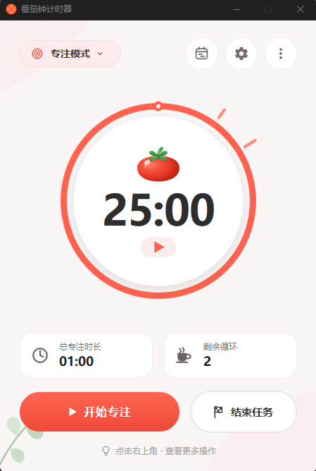
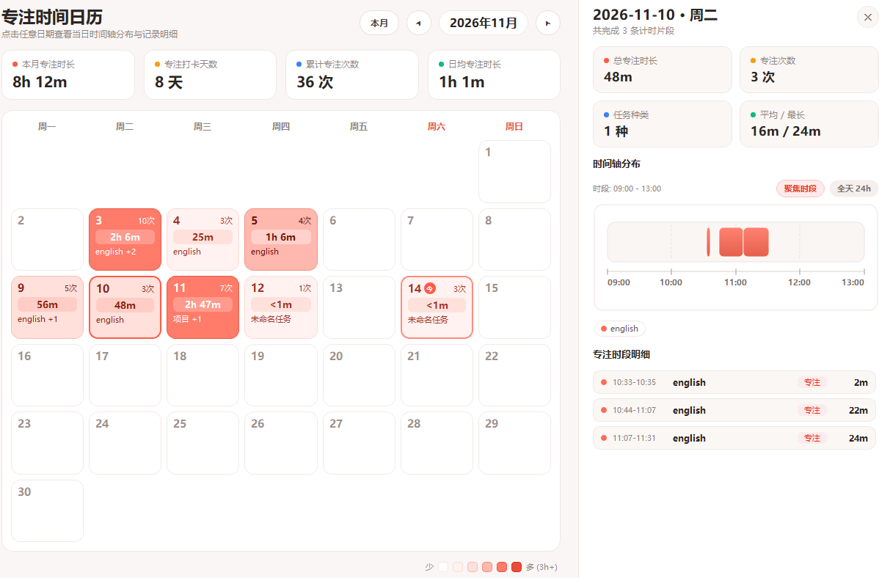

<div align="center">

---

## 💡 编写初衷

一直很喜欢 Windows 时钟自带的「专注时段」体验，但它缺少对历史专注记录的持久化追踪与时间分布回顾。于是基于 PyQt6 开发了这款集**倒计时/自由正计时**、**任务打点**与**日历时间轴可视化**于一体的桌面番茄钟工具。

---

## ✨ 核心特性

- 🎨 **双模式高颜值主题**
  - **专注模式**（暖意珊瑚红）：25 分钟经典番茄倒计时 + 休息循环，搭配动态进度圆环与红番茄插画。
  - **自由模式**（晴空湛蓝）：打破时间与循环限制（`∞`），正向累计专注时长，适合沉浸式心流工作。
  - **休息时间**：自动衔接柔和暖橙色休息倒计时，舒缓用眼疲劳。
- 🎯 **防误触与快捷操控**
  - 顶部左侧胶囊支持一键切换「专注模式 / 自由模式」。
  - 圆形表盘内嵌独立**开始 / 暂停小胶囊**，精准点击防误触。
  - 顶部右侧三枚一级圆钮：**专注日历时间轴**、**设置**、**更多操作**（重置、最小化到任务栏或系统托盘）。
- 📊 **专注时间日历与时间轴**
  - **月度数据概览**：统计本月专注时长、打卡天数、累计专注次数与日均时长。
  - **珊瑚热力日历**：按每日累计时长以色彩深浅直观呈现自律轨迹，点击任意日期展开当日详情面板。
  - **交互式水平时间轴**：自动根据任务分配高区分度配色，支持**「聚焦时段」**与**「全天 24h」**视图一键切换，鼠标悬停可查看开始/结束时间与精确时长。
- ⚙️ **贴心配置与托盘驻留**
  - 支持自定义专注/休息时长、循环次数、最大暂停时间。
  - 支持提示音开关、音量滑动调节与即时试听。
  - 支持自动连播下一轮（自动开始休息/专注）、最小化或关闭窗口时隐藏至系统托盘。
- 💾 **跨平台本地持久化**
  - 自动原子保存专注记录（`main_data.json`）与用户偏好（`config.json`），不依赖云端与联网。

---

## 📸 界面预览

<p align="center">
  
</p>
<p align="center"><sub>主界面：双模式切换胶囊、可绘制圆形番茄进度表盘与顶部一级功能入口</sub></p>

<br/>

<p align="center">
  
</p>
<p align="center"><sub>专注时间日历：月度 KPI 概览、珊瑚热力格子、聚焦时段/24h 时间轴与当日片段明细</sub></p>

---

## 🚀 快速开始

### 方式一：下载可执行文件（推荐 Windows 用户）

1. 前往 [Releases](https://github.com/vegePeapa/Tomato_Clock/releases) 页面下载最新打包版本。
2. 解压后双击运行即可使用（无需安装 Python 环境）。

> **提示**：如遇安全软件误报拦截，请允许程序运行（PyInstaller 单文件/独立打包的常见提示）。

### 方式二：从源码运行

#### 环境要求

- Python 3.8 或更高版本
- PyQt6 `>= 6.0.0`

#### 安装与启动

```bash
# 1. 克隆仓库
git clone https://github.com/vegePeapa/Tomato_Clock.git
cd Tomato_Clock

# 2. 安装依赖
pip install -r requirements.txt

# 3. 启动应用
python main.py
```

---

## 🎯 使用指南

### 1. 开始一段专注

- 点击底部 **「开始专注」** 或表盘内嵌的 **▶ / ||** 小胶囊按钮即可开始或暂停计时。
- 点击左上角 **「专注模式 / 自由模式」** 胶囊可在倒计时番茄钟与无上限正计时之间切换。
- 点击 **「结束任务」** 时可为该次专注填写任务名称，记录将自动归档至当日时间轴。

### 2. 查看专注日历与时间轴

- 点击顶部右上角的 **📅 日历时间轴图标** 即可打开「专注时间日历」。
- 点击日历中的任意日期，右侧详情面板将展示当天的统计卡片、水平时间轴与时间明细列表。
- 在时间轴右上角可自由切换 **「聚焦时段」**（自适应放大有记录的时间段）或 **「全天 24h」** 全览视图。

### 3. 个性化设置

点击顶部右上角 **⚙ 设置图标** 可调整以下选项：

| 分类                   | 配置项                  | 默认值         | 说明                                       |
| :--------------------- | :---------------------- | :------------- | :----------------------------------------- |
| **时间设置**     | 专注时长                | `25 分钟`    | 单次专注倒计时长度                         |
|                        | 休息时长                | `5 分钟`     | 每次专注结束后的休息时长                   |
|                        | 循环次数                | `2 次`       | 一轮完整番茄钟包含的专注次数               |
|                        | 最大暂停时间            | `10 分钟`    | 单次暂停的上限提醒时间                     |
| **声音设置**     | 启用提示音 & 音量       | `开启 / 80%` | 支持调节提示音量并实时点击试听             |
| **常规与自动化** | 自动开始休息 / 专注     | `关闭`       | 计时完成后自动进入下一阶段                 |
|                        | 最小化 / 关闭到系统托盘 | `关闭`       | 隐藏至托盘后台运行，单击托盘图标可快速唤醒 |

---

## 📂 数据存储路径

所有历史专注数据与配置均保存在本地应用目录中：

- **Windows**: `C:\Users\<用户名>\AppData\Local\tomato_clock\`
- **macOS**: `~/Library/Application Support/tomato_clock/`
- **Linux**: `~/.local/share/tomato_clock/`

包含文件：

- `main_data.json` — 按日期归档的每日专注片段记录（任务名、模式、起止时间、持续秒数）
- `config.json` — 用户自定义参数与托盘/声音偏好配置
